  

# ⚡ Awesome System & Service Managers

  
  
  
  
  
  

> **A curated, authoritative directory of PID 1 init systems, daemon supervisors, container process managers, and enterprise Linux service platforms.**  
> *Targeted at DevOps engineers, site reliability engineers (SREs), systems programmers, and Linux/Unix administrators.*

---

## 📑 Table of Contents

- [🔍 Overview](#-overview)
- [📊 Sector Overview & Market Dynamics](#-sector-overview--market-dynamics)
- [🏢 SaaS & Enterprise Commercial Platforms](#-saas--enterprise-commercial-platforms)
- [🚀 Open-Source GitHub Projects](#-open-source-github-projects)
  - [⭐ Top Repositories (Ranked by Stars)](#-top-repositories-ranked-by-stars)
  - [🏛️ Classical Unix & Upstream Inits](#️-classical-unix--upstream-inits)
- [🛠️ Architectural Comparison Guide](#️-architectural-comparison-guide)
- [🤝 How to Contribute](#-how-to-contribute)
- [⭐ Star History](#-star-history)
- [💖 Support & Sponsoring](#-support--sponsoring)
- [📜 Disclaimer & License](#-disclaimer--license)

---

## 🔍 Overview

A **System & Service Manager** serves as the initial user-space process executed by the Linux/Unix kernel—traditionally assigned **Process ID 1 (PID 1)**. PID 1 is uniquely responsible for:
- 🚀 **System Bootstrapping**: Mounting virtual filesystems (`/proc`, `/sys`, `/dev`), loading drivers, configuring networking, and spawning system targets.
- 🔄 **Process Supervision**: Spawning daemons, monitoring health, restarting terminated services, and capturing stdout/stderr streams.
- 🧹 **Zombie Reaping & Signal Routing**: Adopting orphaned child processes and preventing kernel PID exhaustion.
- 🔒 **Resource Sandboxing**: Leveraging Linux cgroups (v1/v2), namespaces, and seccomp profiles to enforce compute limits.
- ⚡ **Socket & Event Activation**: Listening on sockets/buses (D-Bus, UNIX domain sockets) to launch daemons strictly on-demand.

---

## 📊 Sector Overview & Market Dynamics

The enterprise Linux operating infrastructure, server management, and process supervision software market is estimated at **$22.8 Billion** and is projected to expand past **$41.5 Billion** at a compound annual growth rate (CAGR) of **~18.2%**. 

From an ecosystem perspective, the sector exhibits a **dual market dynamic**:
1. **Core Enterprise PID 1 (Highly Concentrated / Winner-Take-Most)**: The traditional server distribution layer is heavily consolidated around `systemd`, which runs on over 90% of production Linux instances globally and is commercially monetized by infrastructure giants including Red Hat (IBM), Canonical, and SUSE.
2. **Container & Edge Micro-Inits (Moderately Fragmented)**: The containerization wave (Docker, Kubernetes, OCI runtimes) created distinct requirements where full-featured init suites are anti-patterns. Lightweight supervisors and signal-forwarding inits (`tini`, `dumb-init`, `s6-overlay`, `dinit`) compete actively across developer microservices, IoT appliances, and hardened container images where sub-second spin-up and minimal binary footprint take precedence.

---

## 🏢 SaaS & Enterprise Commercial Platforms

Enterprise subscriptions provide commercially backed long-term support (LTS), critical kernel/service manager patch guarantees, enterprise compliance certifications (FIPS 140-2, Common Criteria), and unified multi-cloud daemon fleet management.

The table below is sorted descending by **Company Size (Revenue / Valuation)**:

| 🏢 Platform & Vendor | 🎯 Focus & Architecture Scope | 📈 Company Size (Revenue / Valuation) | 💰 Starting Tier Pricing | 🎁 Free Tier / Trial Limits |
| :--- | :--- | :--- | :--- | :--- |
| **[AWS Systems Manager](https://aws.amazon.com/systems-manager/)** *(Amazon Web Services)* | Cloud-native agent (`amazon-ssm-agent`) managing systemd services, automated daemon patching, state configuration, and Run Command across EC2 and hybrid servers. | **~$105 Billion** Annual Revenue *(AWS Segment)* / **~$2.0 Trillion** Market Cap | **$0.00695 / on-premise instance-hour** *(~$5.00 / server / month)*; Core AWS EC2 management features are $0. | **Free forever** for unlimited EC2 instances under Standard Tier (Fleet Manager, Inventory, Run Command, Patch Manager); **30-day free trial** for up to 1,000 on-premise instances. |
| **[Oracle Linux Premier Support](https://www.oracle.com/linux/)** *(Oracle Corporation)* | Enterprise systemd support, Ksplice zero-downtime kernel/daemon patching, Autonomous Linux management, and Unbreakable Enterprise Kernel (UEK). | **~$53 Billion** Annual Revenue / **~$450 Billion** Market Cap | **$1,199 / system / year** *(Basic Support for up to 2 physical CPU sockets or VM)*; Premier Support starts at **$2,299 / system / year**. | **100% free forever** for all production binaries, ISO downloads, package errata, and security updates without contracts; **Oracle Cloud Always Free** tier includes 2 AMD VMs + 4 ARM cores (24GB RAM). |
| **[Red Hat Enterprise Linux (RHEL)](https://www.redhat.com/en/technologies/linux-platforms/enterprise-linux)** *(Red Hat / IBM)* | Industry-standard commercial systemd enterprise distribution with 10-year lifecycle support, automated service failover, and SELinux integration. | **~$6.5 Billion** Annual Revenue *(Red Hat)* / **~$200+ Billion** Market Cap *(IBM)* | **$179 / system / year** *(RHEL Server Self-Support / Entry Level)*; Standard 24/5 commercial support starts at **$799 / system / year**. | **Red Hat Developer Subscription for Individuals** provides **16 physical or virtual nodes free forever** for development and production workloads. |
| **[SUSE Linux Enterprise Server (SLES)](https://www.suse.com/products/server/)** *(SUSE Group)* | Enterprise systemd orchestration, SUSE Manager integration for multi-Linux daemon tracking, and transactional rolling updates. | **~$714 Million** Annual Revenue / **~$2.8 Billion** Enterprise Valuation | **$490 / system / year** *(Basic 1-2 Sockets or VM with 1-year maintenance portal)*; Standard 12x5 phone/ticket support starts at **$856 / year**. | **60-day free trial** with full access to official SUSE package repositories, maintenance updates, security patches, and support knowledgebase for 1 system. |
| **[Canonical Ubuntu Pro](https://ubuntu.com/pro)** *(Canonical Ltd.)* | Extended 10-to-12 year security maintenance for systemd and core daemons, Livepatch rebootless kernel updates, and landscape fleet management. | **~$251 Million** Annual Revenue / **~$3.0 Billion** Estimated Valuation | **$25 / desktop / year**; **$500 / server / year** *(Full 24/7 phone/ticket enterprise support starts at $3,400 / server / year)*. | **Free forever for personal use on up to 5 machines** (covers full Ubuntu Pro security patches); extended up to **50 machines** for official Ubuntu Community members. |

---

## 🚀 Open-Source GitHub Projects

### ⭐ Top Repositories (Ranked by Stars)

Each project below includes its live stargazer count and links directly to its GitHub stargazers page. Sorted in descending order of stars:

1. **[systemd](https://github.com/systemd/systemd)**   
   *The de facto standard Linux system and service manager* — Written in **C** (LGPL-2.1+). Features aggressive parallelization via socket and D-Bus activation, process tracking through Linux cgroups v2, declarative unit configuration (`.service`, `.socket`, `.target`, `.timer`), on-demand daemon instantiation, journal logging (`journald`), and transactional dependency resolution. Runs on >90% of contemporary Linux distributions (Debian, Fedora, Ubuntu, Arch, RHEL, CentOS, openSUSE).

2. **[tini](https://github.com/krallin/tini)**   
   *A tiny but valid `init` for containers* — Written in **C** (MIT License). Reaps zombie processes and transparently forwards POSIX signals (`SIGTERM`, `SIGINT`, etc.) to child processes. Shipped natively as Docker's built-in init system (`docker run --init`) to prevent container resource leakage.

3. **[Supervisor](https://github.com/Supervisor/supervisor)**   
   *Client/server process control system for UNIX* — Written in **Python** (BSD-derived Repoze License). Controls project-level daemon processes without replacing PID 1. Features `supervisord` (server daemon) and `supervisorctl` (CLI controller), process groups, restart policies on unexpected exits, stdout/stderr logging with automatic log rotation, and event notification handlers.

4. **[dumb-init](https://github.com/Yelp/dumb-init)**   
   *A minimal, lightweight init system for Linux containers* — Written in **C** by Yelp (Apache 2.0). Solves the container PID 1 zombie process reaping and signal handling problems with a statically linked 20 KB binary that acts as a simple process supervisor proxy.

5. **[s6-overlay](https://github.com/just-containers/s6-overlay)**   
   *Container init system based on the s6 supervision suite* — Written in **C and execline** (MIT License). Provides clean multi-process supervision inside Docker/OCI containers, initialization staging scripts, log rotation, deterministic shutdown order, and fine-grained process dependencies.

6. **[supervisord (Go)](https://github.com/ochinchina/supervisord)**   
   *A complete Go-lang implementation of Python Supervisor* — Written in **Go** (Apache 2.0). Operates as a single zero-dependency static binary with built-in HTTP management API, Prometheus metrics exporter, and compatible INI-style configuration syntax.

7. **[OpenRC](https://github.com/OpenRC/openrc)**   
   *Dependency-based init and service manager* — Written in **C (C99) and POSIX sh** (2-Clause BSD). The primary init alternative to systemd, widely used by **Alpine Linux, Gentoo, and Artix**. Supports parallel service startup, dynamic dependency resolution (`need`, `use`, `before`, `after`), unified cgroups v2 isolation, and user services, while strictly delegating logging and network setup to dedicated utilities.

8. **[Circus](https://github.com/circus-tent/circus)**   
   *Process and socket manager built with ZeroMQ* — Written in **Python** (Apache 2.0). Originally created by Mozilla, Circus manages processes and network sockets concurrently, providing dynamic process scaling, resource-based flap detection, real-time metrics streaming, and a reactive HTTP dashboard.

9. **[dinit](https://github.com/davmac314/dinit)**   
   *Fast, dependency-based service monitoring and init system* — Written in **C++** (Apache 2.0). Default service manager for **Chimera Linux**. Features parallel service startup, clean dependency tracking, socket activation, robust daemon supervision, and immediate shutdown/reboot execution with minimal resource utilization.

10. **[s6](https://github.com/skarnet/s6)**   
    *Small, secure supervision suite and init framework* — Written in **C** by Skarnet (ISC License). Follows the Unix modular philosophy of assembling independent, highly reliable utilities (`s6-svscan`, `s6-supervise`, `s6-rc`). Renowned for mathematically verifiable correctness, zero memory allocation during runtime, and millisecond failover.

11. **[Finit](https://github.com/finit-project/finit)**   
    *Fast, plugin-based Linux init system for embedded and server deployments* — Written in **C** (MIT License). Features SysV-compatible runlevels, hotplug device detection, process condition gating, automatic restart throttling, and built-in watchdog timer hardware integration.

12. **[immortal](https://github.com/immortal/immortal)**   
    *Cross-platform *nix process supervisor* — Written in **Go** (BSD-3-Clause). Operates without PID files, providing a standalone supervisor that monitors long-running daemons, supports YAML/CLI configuration, forwards standard signals, and exposes a JSON REST management socket.

13. **[nitro](https://github.com/leahneukirchen/nitro)**   
    *Tiny but flexible init system and process supervisor* — Written in **C** (CC0 / Public Domain). Features a minimalist event-driven state machine that acts as PID 1, spawns supervised worker trees, and captures signals without complex dependency graphs.

14. **[Entrykit](https://github.com/progrium/entrykit)**   
    *Entrypoint tasks and supervisor tools for container runtimes* — Written in **Go** (MIT License). Bundles task runners, environment templating (`render`), multi-process supervisors (`codep`), and signal proxies into container entrypoints.

15. **[runit](https://github.com/void-linux/runit)**   
    *Unix init scheme with service supervision* — Written in **C** (3-Clause BSD). The cornerstone of **Void Linux**. Employs a 3-stage boot model (`/etc/runit/1`, `2`, `3`), supervises services via dedicated directory symlinks (`/var/service/`), provides reliable signal control without PID files, and pairs with `svlogd` for automatic log rotation.

16. **[InitWare](https://github.com/InitWare/InitWare)**   
    *Cross-platform systemd-compatible service management middleware* — Written in **C++** (BSD License). Ports systemd-style declarative unit files and service tracking logic to BSD operating systems (FreeBSD, DragonFly BSD, NetBSD) and non-Linux POSIX kernels.

17. **[Horust](https://github.com/FedericoPonzi/Horust)**   
    *Modern supervisor and init system designed for containers* — Written in **Rust** (MIT License). Features TOML-based service definitions, graceful multi-stage shutdown ordering, health checks, dependency resolution, and memory safety guarantees.

18. **[multirun](https://github.com/nicolas-van/multirun)**   
    *Minimalist init process for multi-process containers* — Written in **C** (Apache 2.0). Runs multiple concurrent background commands in a single container, monitors process exits, and terminates all child processes cleanly when any primary process halts.

19. **[launchd](https://github.com/apple-oss-distributions/launchd)**   
    *Apple's service management framework for macOS and Darwin* — Written in **C** (Apache 2.0 / APSL). Replaced traditional BSD init and `cron`. Controls system and user daemons via XML property lists (`.plist`), pioneering on-demand socket and Mach IPC port activation.

20. **[nanoinit](https://github.com/nanopack/nanoinit)**   
    *Microscopic container init* — Written in **C** (MIT License). Engineered strictly to reap zombie processes and forward signals inside ultra-lean scratch container environments.

---

### 🏛️ Classical Unix & Upstream Inits

*(Historical, distribution-specific, or hosted outside GitHub)*

- **[SysVinit](https://savannah.nongnu.org/projects/sysvinit)** *(GNU Savannah)*  
  The traditional Unix System V init system. Sequentially executes numbered runlevel scripts from `/etc/rc.d/` or `/etc/init.d/`. Predictable, deterministic, and foundational to early Unix history, though lacking native process supervision or parallel startup.
- **[GNU Shepherd](https://savannah.gnu.org/projects/shepherd/)** *(GNU Savannah)*  
  The official service manager of the GNU Operating System and default init for **GNU Guix System**. Written in **Guile Scheme**, providing dynamic runtime dependency resolution, service replacement, and Scheme-based programmable orchestration.
- **[Upstart](http://upstart.ubuntu.com/)** *(Canonical)*  
  Canonical's event-driven init daemon that powered Ubuntu releases from 6.10 to 14.10 before being succeeded by systemd. Introduced reactive state transitions and event-based job activation.
- **[daemontools](https://cr.yp.to/daemontools.html)** *(D. J. Bernstein)*  
  The pioneering process supervision suite that inspired runit, s6, and immortal. Introduced continuous service restarts and self-contained service directory architectures.
- **[BusyBox Init](https://busybox.net/)**  
  Ultra-lean init built into the BusyBox multicall binary. Default choice for embedded Linux routers, OpenWrt, and recovery environments.

---

## 🛠️ Architectural Comparison Guide

| Category | Typical Inits / Supervisors | Startup Mode | Reaps Zombies | Resource Sandboxing | Recommended Use Case |
| :--- | :--- | :--- | :---: | :---: | :--- |
| **Monolithic System Suites** | `systemd` | Parallel + Socket Activation | ✅ | cgroups v2 + Seccomp | Production enterprise Linux servers, bare-metal servers, rich workstations. |
| **Modular POSIX Inits** | `OpenRC`, `runit`, `dinit`, `Finit` | Dependency / Sequential | ✅ | cgroups v2 (OpenRC/dinit) | Minimal distributions (Alpine, Void, Chimera), embedded Linux, IoT gateways. |
| **Container Micro-Inits** | `tini`, `dumb-init`, `s6-overlay` | Single / Multi-process proxy | ✅ | Inherited from Container Engine | Single and multi-daemon Docker/OCI container entrypoints. |
| **Application Supervisors** | `Supervisor`, `supervisord (Go)`, `Circus` | Subprocess Fork | ⚠️ *(Child only)* | User/Group isolation | Web app worker queues (Celery, RQ, Sidekiq), Python/Ruby/Go background jobs. |
| **Declarative Programmable** | `GNU Shepherd` | Scheme Event Loop | ✅ | POSIX capabilities | Guix System, reproducible declarative infrastructure, Scheme environments. |

---

## 🤝 How to Contribute

Contributions are warmly encouraged! To propose updates or add new system & service managers:

1. **Fork the Repository** on GitHub.
2. **Create a Feature Branch**: `git checkout -b feature/add-new-service-manager`.
3. **Add Entry**:
   - For SaaS products: Include vendor, scope, company revenue/valuation, verified starting pricing, and exact free tier/trial terms.
   - For Open-Source projects: Include repository URL, social star badge, implementation language, license, and technical summary.
4. **Follow Formatting Guidelines**: Maintain alphabetical or star-ranked ordering where applicable.
5. **Submit a Pull Request** with a concise description of your changes.

---

## ⭐ Star History

---

## 💖 Support & Sponsoring

If you found this curated directory useful for architecting Linux systems, container runtimes, or production daemon supervision:

- ⭐ **Star this repository** to help other developers and sysadmins discover it.
- 🍴 **Fork the repo** to maintain your own tailored internal stack guide.
- 📢 **Share the project** with your DevOps teams, subreddits, and Discord channels.
- ☕ **Support the maintainer**: Sponsor ongoing curation and research via the [GitHub Sponsors Dashboard](https://github.com/sponsors/ishandutta2007).

---

## 📜 Disclaimer & License

- This list is independently curated for educational and architectural reference.
- Product names, logos, and brands are property of their respective owners.
- Distributed under the [MIT License](LICENSE).
